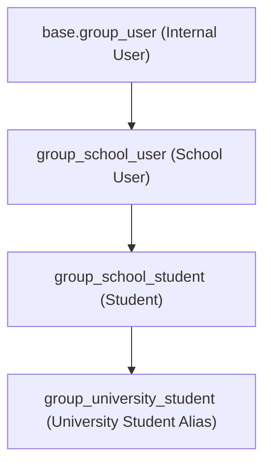

# Student Role Features & Capabilities Specification

**Module:** `school_management` (University Management System for Odoo 19.0)  
**Security Group:** `school_management.group_school_student` (University Student)  
**Target File Reference:** [classroom.py](file:///C:/Odoo/odoo/custom/school_management/models/classroom.py)  
**Documentation Path:** `C:\Odoo\odoo\custom\school_management\document\student_role_features.md`  

---

## 1. Executive Summary

In the **Odoo 19 University Management System**, the **Student** role (`group_school_student`) is designed to provide learners with an intuitive, self-service Academic Experience. The role blends a dedicated OWL-based single-page application (SPA)—the **Student Dashboard Shell**—with standard Odoo ERP views and a responsive web portal (`/my/student/dashboard`).

Students have strictly scoped **read-only** visibility over master curriculum and university data, **isolated row-level access** to their own academic and financial records, and **interactive write/create capabilities** for coursework submissions, absence excuse filings, and official transcript requests.

---

## 2. Role Architecture & Security Framework

### 2.1 Group Hierarchy
The `group_school_student` belongs to the `school_management_privilege` category ("University Management") and inherits foundational system access:

- **Identity Linkage:** Every student user account (`res.users`) is linked to an underlying student record (`university.student`) via the `user_id` field.
- **Data Isolation:** Record rules dynamically evaluate `user.id` to prevent cross-student record visibility.

### 2.2 Permissions Matrix (`ir.model.access.csv`)

| Model Technical Name | Model Description | Read | Create | Write | Delete | Notes / Scoping |
| :--- | :--- | :---: | :---: | :---: | :---: | :--- |
| `university.student` | Student Profile | ✅ | ❌ | ❌ | ❌ | Read own profile record |
| `university.classroom` | University Classrooms | ✅ | ❌ | ❌ | ❌ | Room info, amenities, building/floor |
| `university.class.section` | Class Sections / Course Offerings | ✅ | ❌ | ❌ | ❌ | Enrolled class sections |
| `university.class.schedule.line` | Recurring Class Schedules | ✅ | ❌ | ❌ | ❌ | Enrolled class schedule patterns |
| `university.timetable.slot` | Timetable Session Slots | ✅ | ❌ | ❌ | ❌ | Published timetable sessions |
| `university.subject` | Subject Catalog | ✅ | ❌ | ❌ | ❌ | Course information & descriptions |
| `university.curriculum` | Degree Curriculum | ✅ | ❌ | ❌ | ❌ | Program curriculum structure |
| `university.curriculum.line` | Curriculum Course Lines | ✅ | ❌ | ❌ | ❌ | Core & elective requirements |
| `university.assignment` | Course Assignments | ✅ | ❌ | ❌ | ❌ | Enrolled class assignments |
| `university.assignment.submission` | Assignment Submissions | ✅ | ✅ | ✅ | ❌ | Upload files, submit homework |
| `university.attendance` | Attendance Records | ✅ | ❌ | ❌ | ❌ | Read attendance history |
| `university.exam` | University Exams | ✅ | ❌ | ❌ | ❌ | Published exam schedules |
| `university.exam.score` | Exam & Quiz Scores | ✅ | ❌ | ❌ | ❌ | Own published exam scores |
| `university.report.card` | Semester Report Cards | ✅ | ❌ | ❌ | ❌ | Own official term grades |
| `university.report.card.line` | Report Card Subject Lines | ✅ | ❌ | ❌ | ❌ | Subject-level grades & credits |
| `university.transcript` | Academic Transcripts | ✅ | ❌ | ❌ | ❌ | Cumulative GPA & full history |
| `university.transcript.line` | Transcript Course Lines | ✅ | ❌ | ❌ | ❌ | Historical grade points earned |
| `university.transcript.request` | Official Transcript Requests | ✅ | ✅ | ✅ | ❌ | Submit official transcript requests |
| `university.fee` | Student Fee Invoices | ✅ | ❌ | ❌ | ❌ | Tuition assessments & invoices |
| `university.fee.line` | Tuition Fee Breakdown Lines | ✅ | ❌ | ❌ | ❌ | Itemized fee breakdown |
| `university.payment` | Student Payment Receipts | ✅ | ❌ | ❌ | ❌ | Recorded payments & transactions |
| `university.notice.board` | Campus Notice Board | ✅ | ❌ | ❌ | ❌ | Broadcast announcements |
| `university.student.followup` | Academic Advising Follow-ups | ✅ | ❌ | ❌ | ❌ | Visible advisor notes & interventions |
| `university.teacher` | Faculty & Instructors | ✅ | ❌ | ❌ | ❌ | Instructors for enrolled classes & advisor |
| `university.department` | Academic Departments | ✅ | ❌ | ❌ | ❌ | Own department info |
| `university.faculty` | University Faculties | ✅ | ❌ | ❌ | ❌ | Own faculty/college info |
| `university.program` | Degree Programs | ✅ | ❌ | ❌ | ❌ | Own academic degree program |
| `university.service.hour` | Community / Service Hours | ✅ | ✅ | ✅ | ❌ | Log extracurricular service hours |

---

## 3. Classroom Integration (`models/classroom.py`)

A key component referenced in [classroom.py](file:///C:/Odoo/odoo/custom/school_management/models/classroom.py) is `university.classroom`. The student role interacts with this model as follows:

### 3.1 Classroom Data Visible to Students
Students have **read-only access** to classroom data, enabling them to discover where classes, labs, and exams take place:

1. **Room Identity & Location:**
   - `name`: Room Name / Room Number (e.g., `Lab 302`, `Room 101`, `Main Hall`).
   - `building`: Campus building code (e.g., `Building A`, `Building B`, `Building C`).
   - `floor`: Floor level (e.g., `Ground Floor`, `2nd Floor`, `3rd Floor`).
   - `display_name`: Computed identifier in format `[Building] Room Name` (e.g., `[A] Room 204`).
2. **Room Type & Classification:**
   - `room_type`: Selection between `Lecture Hall`, `Standard Classroom`, `Laboratory`, or `Auditorium`.
   - `room_type_icon`: Visual icon representing the space (`fa-flask` for labs, `fa-university` for lecture halls, `fa-microphone` for auditoriums).
3. **Facilities & Equipment Checklist:**
   - `has_projector`: Availability of high-definition projector or interactive display.
   - `has_air_conditioning`: Climate control indicator.
   - `has_wifi`: High-speed campus Wi-Fi availability.
   - `has_sound_system`: Microphone and acoustic amplification system.
   - `has_computers`: Dedicated computer workstations (essential for lab sessions).
   - `has_whiteboard`: Smartboard or standard dry-erase whiteboard.
   - `has_video_conference`: Hybrid/distance learning hardware.
   - `facilities`: Descriptive equipment breakdown.
4. **Visual Accent & Color Coding:**
   - `color`: Integer color index linked to campus building palettes (Building A = Blue, Building B = Orange, Building C = Teal, etc.), used in student timetable slots and calendar chips.
   - `image_1920`: Room photo allowing students to physically recognize the classroom.

### 3.2 Where Students Encounter Classroom Data
- **Weekly Schedule & Calendar:** Each session card in the timetable displays the assigned classroom name, building, and floor.
- **Class Section View:** Course schedules detail recurring class slots with their designated lecture hall or laboratory.
- **Timetable Slot Modal / Details Sidebar:** When clicking a session in the schedule, students see complete room amenity details (e.g., "Bring your own laptop — Lab has Wi-Fi and Projector").

### 3.3 Security & Operational Boundaries
- Students **cannot** change classroom availability status (`action_set_available`, `action_set_maintenance`, `action_set_occupied`, `action_set_inactive`).
- Students **cannot** edit room capacity, photos, or facilities.
- Duplicate top-level menus (`menu_student_nav_classrooms`) are intentionally deactivated in navigation in favor of direct contextual embedding inside the student's **Schedule** and **Class Section** views.

---

## 4. Feature Breakdown by Functional Domain

### 4.1 Student Dashboard Shell (Interactive OWL SPA)
The student's default landing view (`action_student_dashboard_shell`) is an OWL component loaded full-screen:

1. **Header & Academic Status:**
   - Time-sensitive greeting (`Good Morning / Good Afternoon`).
   - Student ID, Degree Program, Department, and Status Badge (`Active`, `Probation`, `Alumni`).
2. **Key Academic Metric Cards (KPIs):**
   - **Cumulative GPA:** Real-time GPA with honor badges (e.g., Dean's List for GPA $\ge 3.5$).
   - **Attendance Rate:** Percentage badge with at-risk indicator if attendance falls below 80%.
   - **Completed Credits:** Progress bar showing earned credits versus required program graduation credits.
   - **Academic Risk Level:** Early warning indicator (`Normal`, `Warning`, `Critical`, `Probation`) with advisor reason.
   - **Financial Balance:** Outstanding tuition balance with direct link to payment history.
3. **Today's Classes & Timetable Strip:**
   - Next upcoming session card showing Subject, Time Slot, Instructor, and **Classroom / Building**.
4. **Enrolled Courses Grid:**
   - Card deck of current classes with course codes, credits, instructor details, and quick syllabus modal launcher.
5. **Advisor Follow-ups & Announcements:**
   - Direct alert feed of visible academic advising notes and university notices.

---

### 4.2 Timetable, Scheduling & Campus Calendar

1. **University Schedule (`menu_student_nav_schedule`):**
   - **Agenda Mode:** Day-by-day chronological list of scheduled classes.
   - **Week / Grid Mode:** Matrix view of Monday–Friday timeslots.
   - **Navigation:** Next/Previous week offset buttons and "Today" quick filter.
   - **Classroom Visibility:** Every slot specifies room number, building, and floor.
2. **Public Holiday Integration:**
   - Real-time display of academic holidays, semester breaks, and exam reading periods sourced from `school_public_holiday`.
3. **Academic Calendar App:**
   - Synchronized personal calendar events, scheduled classes, and assignment deadlines.

---

### 4.3 My Classes & Degree Curriculum

1. **My Classes (`menu_student_nav_classes`):**
   - Enrolled class sections for the current academic semester.
   - Instructor contact information and office hours.
   - Interactive Syllabus Modal: Course objectives, weekly outline, and required textbooks.
2. **My Curriculum (`menu_student_nav_curriculum`):**
   - Complete 4-year degree roadmap organized by Semester.
   - Categorization by **Core Subjects**, **Major Electives**, and **General Education**.
   - Prerequisite checking: Highlights completed prerequisites before course registration.
   - **PDF Curriculum Export:** Single-click generation of the official curriculum roadmap PDF.

---

### 4.4 Coursework, Assignments & Submissions

1. **My Assignments (`menu_student_nav_assignments`):**
   - Filter by status: `Pending`, `Submitted`, `Graded`, `Overdue`.
   - Homework briefs, attached guidelines, submission deadlines, and maximum points.
2. **My Submissions (`menu_student_nav_submissions`):**
   - Multi-file attachment upload for completed coursework.
   - Submission state machine: `Draft` $\rightarrow$ `Submitted` $\rightarrow$ `Graded` / `Returned`.
   - Instructor feedback viewer: View grading rubrics, letter grades, points awarded, and teacher commentary.

---

### 4.5 Attendance History & Excuse Requests

1. **Attendance Performance Breakdown (`menu_student_nav_attendance`):**
   - Aggregate attendance percentage calculation.
   - Status counters: `Present`, `Late`, `Absent`, `Excused`.
   - Course-by-course attendance rates to prevent missing minimum class hour requirements.
2. **Attendance Log Table:**
   - Date, subject, session timeslot, room location, and recorded status.
3. **Absence Excuse Submission Modal:**
   - Self-service form allowing students to submit excuse notes for missed sessions.
   - Fields: Target Class Section, Date of Absence, Reason Category (`Medical`, `Family Emergency`, `Official University Duty`), and Supporting Notes.

---

### 4.6 Academic Records, Exams & Official Transcripts

1. **Exam Schedules & Scores:**
   - Published midterm, final, and quiz schedules.
   - Confidential view of personal published scores (`university.exam.score`).
2. **Semester Report Cards (`menu_student_nav_report_cards`):**
   - Formal term report cards with Term GPA, credit hours completed, and grade scale distribution.
3. **Academic Transcript (`menu_student_nav_my_transcript`):**
   - Comprehensive multi-semester academic transcript.
   - Historical course listing, letter grades (A, B+, etc.), grade points, and total degree GPA.
4. **Official Transcript Requests (`menu_student_nav_transcript_requests`):**
   - Online request workflow for paper/digital sealed transcripts.
   - Submission form: Number of copies, delivery method (Digital PDF, Campus Pickup, Courier), and purpose (Employment, Graduate School, Visa).
   - Live status tracking: `Draft` $\rightarrow$ `Submitted` $\rightarrow$ `In Review` $\rightarrow$ `Approved` $\rightarrow$ `Ready / Dispatched`.

---

### 4.7 Tuition, Fees & Financial Status

1. **Tuition & Fees (`menu_student_nav_fees`):**
   - Summary of total tuition assessed, scholarship deductions, total paid, and balance due.
   - Itemized fee lines: Tuition fees, lab fees, library fees, registration dues.
2. **Payment History:**
   - Transaction date, amount, payment method (Bank Transfer, Cash, Card), and official university receipt reference.

---

### 4.8 Communication, Advising & Campus Life

1. **Campus Notice Board (`menu_university_notice_board`):**
   - University-wide broadcasts, faculty announcements, and urgent schedule adjustments.
   - Severity tags: `Important`, `General`, `Urgent`.
2. **Academic Advising & Follow-ups:**
   - Direct access to visible guidance notes and academic intervention plans recorded by the assigned faculty advisor.
3. **Discuss & Messaging (`mail.thread`):**
   - Real-time chatter messages with instructors directly on assignment cards and student profile.

---

## 5. UI & Screenshot Catalog Reference

The visual verification screenshots for the Student Role are stored in:  
`C:\Odoo\odoo\custom\school_management\document\screenshots_student\`

| Index | Feature Screen | File Reference | Key Capabilities Demonstrated |
| :---: | :--- | :--- | :--- |
| **01** | Student Dashboard | `01_student_dashboard.png` | KPI cards, Today's schedule, Enrolled courses, Alerts |
| **02** | University Schedule | `02_student_schedule.png` | Weekly calendar, Agenda view, Classroom locations |
| **03** | My Classes | `03_my_classes.png` | Section list, Instructor info, Syllabus launcher |
| **04** | My Curriculum | `04_my_curriculum.png` | Semester roadmap, Core/Elective courses, Credits |
| **05** | My Assignments | `05_my_assignments.png` | Assignment briefs, Due dates, Grading weights |
| **06** | My Submissions | `06_my_submissions.png` | File uploads, Status badges, Instructor grading feedback |
| **07** | Attendance History | `07_attendance_history.png` | Attendance rate %, Session breakdown, Excuse modal |
| **08** | Public Holidays | `08_public_holidays.png` | Academic calendar holidays, Breaks, Non-working days |
| **09** | Academic Transcript | `09_academic_transcript.png` | Complete GPA records, Historical courses, Letter grades |
| **10** | Semester Report Cards | `10_report_cards.png` | Term-by-term official report cards and evaluations |
| **11** | Transcript Requests | `11_transcript_requests.png` | Request filing modal, Tracking status lifecycle |
| **12** | Tuition & Fees | `12_tuition_and_fees.png` | Invoices, Balance overview, Receipts, Payment history |
| **13** | Student Profile | `13_student_profile.png` | Bio, Contact details, Emergency info, Advisor name |
| **14** | Notice Board | `14_notice_board.png` | Campus announcements, Event notices, Bulletins |
| **15** | Student Web Portal | `15_student_web_portal.png` | Responsive portal access via `/my/student/dashboard` |
| **16** | Discuss & Messages | `16_discuss_app.png` | Instructor messaging, Direct chats, Course chatter |
| **17** | Academic Calendar | `17_calendar_app.png` | Monthly/Weekly personal and class calendar view |

---

## 6. Summary Checklist for System Administrators

To ensure a user operates with full student role functionality:
1. Assign the user to **Student** (`school_management.group_school_student`).
2. Link the `res.users` record to a corresponding `university.student` profile via the `user_id` relational field.
3. Verify enrollment status in `university.enrollment` (`status = 'enrolled'`) to automatically populate class sections, timetable slots, assignments, and classroom schedules.
